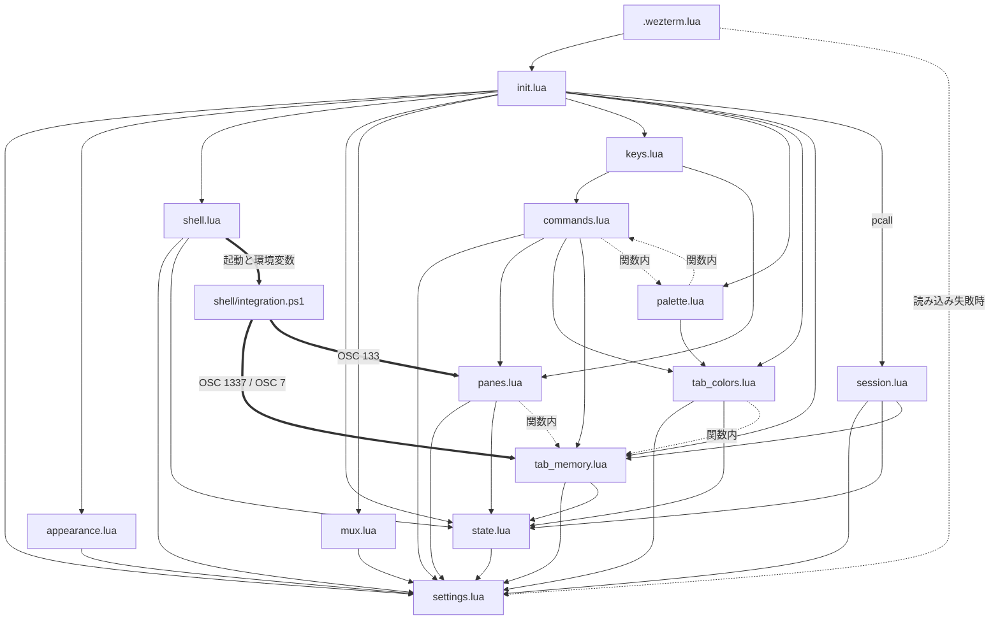

# アーキテクチャ

この文書は、Windows の WezTerm を kitty（kitty-ja-shortcuts 入り）と同じキー操作にする設定 `kitty_ja` と、そのインストーラー・配布物の作り方の設計をまとめたものである。

- 記述は、リポジトリのコードを読んで確かめた内容に限る。コードから確かめられないことは、その旨を書く。
- 「〜のコメント」と書いたものは、その理由や前提がソースコード中のコメントに書かれていることを示す。
- セキュリティ上の制限の詳細は [SECURITY-MODEL.md](SECURITY-MODEL.md) にある。

## 1. リポジトリの構成

| パス | 役割 |
|---|---|
| `.wezterm.lua` | WezTerm が読む入口ファイル（entry file）。`kitty_ja` を読み込み、この設定独自の追加をする |
| `kitty_ja\` | 設定本体の Lua モジュール（module）群 |
| `kitty_ja\shell\integration.ps1` | PowerShell 7 の中で動くシェル連携（shell integration）のスクリプト |
| `defaults\colors.txt` | タブ色の初期定義 |
| `install.ps1`、`install.cmd` | インストーラー |
| `uninstall.ps1`、`uninstall.cmd` | アンインストーラー |
| `tools\New-Package.ps1` | 配布用 zip の作成と、配布物の検査 |
| `tools\Test-Installer.ps1` | インストーラーと zip の作成を、使い捨てのホームフォルダで確かめる検査 |

インストール後の配置（`install.ps1`）は次のとおり。

| 配布物 | 置く場所 |
|---|---|
| `kitty_ja\` | `<ホーム>\.config\wezterm\kitty_ja\` |
| `.wezterm.lua` | `<ホーム>\.wezterm.lua` |
| `defaults\colors.txt` | `<ホーム>\.config\wezterm-kitty-ja\tab-colors\colors.txt`（無いときだけ） |

## 2. 起動の流れ

### 2.1 設定の評価

WezTerm は `<ホーム>\.wezterm.lua` を Lua として評価し、返された設定表を使う。評価は次の順に進む。

1. `.wezterm.lua` が `wezterm.config_builder()` で設定表を作り、`pcall(require, 'kitty_ja')` で本体を読み込む。
   `require 'kitty_ja'` が `<ホーム>\.config\wezterm\kitty_ja\init.lua` を指すのは、WezTerm の Lua モジュールの検索パスによる。検索パスの中身は、このリポジトリのコードからは確認できない。
2. `init.lua` を読み込む時点で、次の順に各モジュールが読まれる（`require` の連鎖。読み込み済みのものは読み直さない）。
   1. `settings.lua`: 読み込み時に PowerShell 7 と Notepad++ の場所を探し（`find_pwsh`、`find_in_program_files`）、データファイルのパスを決める
   2. `appearance.lua`
   3. `shell.lua`（ここで `state.lua` も読まれる）
   4. `mux.lua`: mux-server 構成の unix ドメインの登録（4.11）
   5. `keys.lua`（ここで `commands.lua` が読まれ、その中で `panes.lua`・`tab_colors.lua`・`tab_memory.lua` が読まれる）
   6. `palette.lua`
   7. `session.lua`: これだけは `pcall(require, 'kitty_ja.session')` で読む。読めなかったときはエラーを記録し、タブ構成の保存と復元を除いて動く（`session_ok`）
3. `.wezterm.lua` が `init.lua` の `apply_to_config(config)` を呼ぶ。中では次の順に処理する。
   1. `appearance.apply`: フォント、ベル、タブバーの見た目
   2. `shell.apply`: 既定のシェル（`default_prog`）と、シェルへ渡す環境変数
   3. `mux.apply`: `settings.mux_server` が true なら、`config.unix_domains` に unix ドメインを足し、`config.default_gui_startup_args` を `{ 'connect', <ドメイン名> }` にする
   4. `keys.apply`: `config.keys` と `config.key_tables` を作る。このとき `colors.txt` を読む
   5. `mux.apply_keys`: `settings.mux_server` が true なら、mux 経由で別のキーとして届いてしまう Ctrl+J・Shift+Enter・Ctrl+Enter の割り当てを、`config.keys` の末尾へ足す（`keys.apply` が `config.keys` を作り直すので、その後に呼ぶ。4.11）
   6. `wezterm.add_to_config_reload_watch_list(settings.colors_file)`: `colors.txt` を保存すると、設定が読み直される
   7. イベント（event）の登録: `format-tab-title`、`update-status`、`user-var-changed`、`gui-startup`（`session.lua` を読めたときだけ）、`mux-startup`（`settings.mux_server` が true のときだけ）
   8. `palette.register`: コマンドパレットで選ばれたときのイベント `kitty-ja-palette-selected` を登録する
4. `.wezterm.lua` に戻り、`scrollback_lines` を 100000 以上にし、Ctrl+Shift+E の割り当てを差し替える（2.3）。

`kitty_ja` を読み込めなかったときは、`.wezterm.lua` が `kitty_ja.settings` だけを読み、PowerShell 7 が見つかれば `default_prog` にする。このときシェル連携は動かない。

### 2.2 実行中のイベント

| イベント | 呼ばれる関数 | 役割 |
|---|---|---|
| `gui-startup` | `session.on_gui_startup` | 前回のタブ構成を作り直す。`wezterm connect` で起動した GUI では発火しない（4.11） |
| `mux-startup` | `state.publish_shell_token`、続けて `session.on_mux_startup` | mux-server の起動時にだけ発火する。合言葉をファイルへ公開し、前回のタブ構成を作り直す（4.11） |
| `update-status` | `tab_memory.on_update_status`、続けて `session.on_update_status` | 新しいタブや名前の変化を拾い、その結果のタブ構成を保存する |
| `user-var-changed` | `tab_memory.on_user_var_changed` | シェルからのフォルダの通知を受けて、タブ名・タブ色を合わせる |
| `format-tab-title` | `tab_colors.format_tab_title` | タブ名と色を描く。失敗したら何も返さず、WezTerm 標準の表示に任せる |
| `kitty-ja-palette-selected` | `palette.lua` の `on_selected` | パレットで選ばれたコマンドを実行する |

- `update-status` では、タブ記憶が名前・色を確定させてから、その結果を保存する順にしている（`init.lua` のコメント）。
- `format-tab-title` は最初に登録した 1 個しか実行されないので、`init.lua` 以外では登録しない（`init.lua` のコメント）。
- `update-status` はウィンドウごとに毎秒来る（`session.lua` のコメント）。この設定は間隔を変えていない。

### 2.3 `.wezterm.lua` の追加設定

- **Ctrl+Shift+E の差し替え**: `kitty_ja` が作った `config.keys` から、Ctrl+Shift+E とみなせる割り当てを全て除く（`is_ctrl_shift_e`）。代わりに `open-scrollback-in-notepadpp` イベントを、`phys:E`（Ctrl+Shift）、`mapped:E`（Ctrl）、`mapped:e`（Ctrl+Shift）と、切り分け用の Ctrl+Alt+Shift+F12 に割り当てる。
- **`open-scrollback-in-notepadpp`**: 選択中のペインの画面とスクロール履歴（scrollback）を、`%TEMP%` の `wezterm-history-<日時>-pane-<ペイン番号>.txt` に BOM 付き UTF-8 で書き、Notepad++ で開く（`find_notepadpp`）。
- この結果、`commands.lua` で Ctrl+Shift+E に割り当てた「画面上の URL を選んで開く」（`open_url_with_hints`）は、キーからは呼べず、コマンドパレットからだけ呼べる。
- `notepadpp_override`: Notepad++ を標準以外の場所に入れたときに、そのパスを書く変数。

### 2.4 設定の再読み込みをまたぐ状態

設定の再読み込みをまたいで残す状態は、`wezterm.GLOBAL` に置く（`state.lua`）。

- `state.load` / `state.save`: タブごとの状態などを、JSON 文字列 1 個として `kitty_ja_state` に置く。入れ子のテーブルの代入や nil の扱いに依存しないため（`state.lua` のコメント）。中身は次の 3 つ。
  - `tabs`: `t<タブ番号>` → `cwd`、`look`、`auto`、`colors`
  - `pending`: 初回処理を待っているタブと、待ち始めた時刻
  - `maximized`: `w<ウィンドウ番号>` → 最大化中か
- そのほかのキー: 合言葉（`kitty_ja_shell_token`）、復元中の印（`kitty_ja_restoring_since`）、パレットの未割当表示（`kitty_ja_palette_show_unmapped`）、タブバーの描き直し用の値（`kitty_ja_redraw_w<ウィンドウ番号>`）、`session.lua` の保存の状態（`kitty_ja_session_` で始まるキー）。

## 3. モジュールの責務と依存

| モジュール | 責務 |
|---|---|
| `init.lua` | 本体の入口。各モジュールの `apply` を呼び、イベントを登録する |
| `settings.lua` | 環境に合わせて変える値の置き場所。データファイルのパス、フォントサイズ、エディタ、PowerShell 7 の検出 |
| `appearance.lua` | フォント、ベル、タブバーの見た目 |
| `shell.lua` | 既定のシェルと、シェル連携へ渡す環境変数 |
| `mux.lua` | シェルを wezterm-mux-server に持たせ、GUI をそこへ接続させる設定（unix ドメインの登録と、GUI の起動引数）。mux 経由で別のキーとして届く Ctrl+J・Shift+Enter・Ctrl+Enter の補正 |
| `state.lua` | `wezterm.GLOBAL` に置く状態、合言葉（mux 構成では、サーバーとの共有）、復元中の印、タブバーの描き直し |
| `commands.lua` | コマンド表。キー割り当てとコマンドパレットの唯一の定義元 |
| `keys.lua` | コマンド表から `config.keys` と `config.key_tables` を作る |
| `palette.lua` | 日本語のコマンドパレット（選択画面と検索語） |
| `panes.lua` | WezTerm の標準アクション 1 個では表せない操作（ペインの作成、リサイズ、フォントサイズ、透明度、最大化、貼り付け、画面の文字列を開く操作、ヒント） |
| `tab_colors.lua` | `colors.txt` の読み込み、タブ色の変更、タブの描画 |
| `tab_memory.lua` | フォルダごとのタブ名・タブ色の記憶と復元。ペインの現在のフォルダの取得と、パスの検査 |
| `session.lua` | タブ構成の保存（`session.json`）と、次回起動時の復元 |
| `shell\integration.ps1` | PowerShell 7 の中で、現在のフォルダとプロンプトの位置を WezTerm に通知する |

依存の関係は次のとおり。実線はファイルの先頭での `require`、「関数内」の点線は関数の中で `require` するもの（遅延 require（lazy require））、太線は `require` ではない連携である。

- `commands.lua` と `palette.lua` は互いを使うが、どちらも相手を関数の中で `require` するので、読み込みの時点では循環しない。
- `settings.lua` は、`wezterm` 以外のモジュールを読まない。`state.lua` は、`settings.lua` だけを読む（合言葉のファイルのパスのため）。

## 4. 設計上の工夫

### 4.1 コマンド表を唯一の定義元にする

- `commands.lua` の `module.entries` が全コマンドの表である。各項目は `id`、`keys`、`label`、`name`、`yomi`、`category`、`action`、`key_action`、`hidden` を持つ。
- `keys.lua` の `apply` は、この表（と `commands.color_entries`）の `keys` を順に読んで割り当てを作る。キーから実行するのは `key_action`、無ければ `action` である。
- `palette.lua` の `build_rows` は、同じ表のうち `hidden` でない項目をパレットの行にする。選ばれたら `commands.find` で項目を引き、`action` を実行する（`on_selected`）。
- 1 つの表から両方を作るので、キーとパレットの表示は食い違わない。例外は 2.3 の Ctrl+Shift+E で、入口ファイルが後から割り当てを差し替える。
- `key_action` は、キーとパレットで動作を変えたいときに使う。フォントの拡大・縮小は、キーでは `settings.font_size_step_key`（2.0）、パレットでは `settings.font_size_step_palette`（1.0）ずつ変える。
- `hidden = true` の項目はキーだけに割り当て、パレットには出さない（kitty の既定キーのうち、kitty 側のパレットの一覧 `commands.tsv` に無いもの）。
- Ctrl+Shift+1〜0 の「番号でペインへ移動」は、ループで表に足す。
- タブ色の項目は `colors.txt` から作る（`commands.color_entries`）。キーは設定の読み込み時に決まり、色は押した時点の定義で決まる（`tab_colors.color_action`）。

### 4.2 物理キーで割り当て、JIS 配列でも同じ位置で動かす

- `keys.lua` の `key_variants` が、`ctrl+shift+t` のような 1 打鍵の指定を、WezTerm の `{ key, mods }` の配列にする。先頭には必ず物理キー（physical key）の指定 `phys:<キー>` を入れる。
- WezTerm は物理キーの割り当てを最初に照合するので、標準の割り当てより優先され、JIS 配列で記号の文字が US 配列と違っても、同じキー位置で動く（`keys.lua` のコメント）。
- 記号は `NAMED_KEYS` で物理キーの名前に直す（例: `` ` `` は `Grave`、`=` は `Equal`）。JIS 配列では `` ` `` の位置が @ のキー、`=` の位置が `;` のキーなので、Ctrl+Shift+@ がペインの入れ替え、Ctrl+Shift+; が拡大になる（`commands.lua` のコメント）。
- 予備として、配列に従う通常（mapped）の指定も併せて登録する。
  - 英字: 小文字。Shift を含むときは、大文字と、Shift を除いた大文字も足す
  - 数字: Shift を含まないときだけ足す（Shift と数字で届く文字は、配列によって違うため）
  - ファンクションキーと名前付きのキー（Enter、矢印など）: 同じ名前の通常の指定を足す
  - 記号: 足さない（物理キーだけ）
- 解釈できない指定は `error` にし、`apply` の中の `bind` が `pcall` で受けて警告を記録する。1 個の誤りで、ほかの割り当てが止まらない。

### 4.3 2 段キーとモードをキーテーブルで作る

- コマンド表では、`ctrl+shift+a>m` のように `>` で 2 段キー（multi-key shortcut）を書く。「Ctrl+Shift+A を押して離してから M」を意味する。
- `keys.lua` の `apply` は、指定を `^(.-)>(.+)$` で 1 段目と 2 段目に分け、2 段目をキーテーブル（key table）に入れる。テーブル名は `CHORD_TABLE_NAMES`（`ctrl+shift+a` は `opacity`、`ctrl+shift+p` は `hints`）で決め、無ければ 1 段目から `chord_` で始まる名前を作る（`chord_table_name`）。
- 1 段目には `ActivateKeyTable { name = <テーブル名>, one_shot = true, until_unknown = true }` を割り当てる。次の 1 打鍵でテーブルを抜け、テーブルに無いキーでも抜ける。Esc は `PopKeyTable` である。
- リサイズモード（Ctrl+Shift+R）は、`resize_window` テーブルを `one_shot = false` で有効にする。w / n / t / s で 1 セル、Ctrl を併せて 2 セル動かし、Esc・q・Enter で抜ける。
- リサイズの向き（`panes.lua` の `resize_action`）: WezTerm の `AdjustPaneSize` は境界線を動かす向きを取るので、右（または下）に隣のペインがあるかを `get_pane_direction` で調べて向きを決める。

### 4.4 日本語のコマンドパレット

- WezTerm の選択画面（InputSelector）を、あいまい検索（fuzzy search）で使う（`palette.lua` の `show`）。
- 選択画面は IME で確定した文字を受け取れない（`palette.lua` のコメントでは WezTerm 20240203 の制限）。そこで各行の、画面の幅より右（画面の外）に、読みのローマ字とコマンドの `id` を検索語として足す（`make_label`）。検索は行全体に対して行われ、表示は画面の幅で切られるので、検索語は見えない。
- 見える部分を画面の幅にちょうど合わせるため、全角を 2 桁として数えて切り詰め、空白で埋める（`fit`。文字の幅は `wezterm.column_width`）。幅は、分割したペインではなくタブの桁数から決める（`selector_columns`）。ペインの桁数で作ると、分割したタブで行が短くなり、検索語が画面に出てしまうため。
- 読みはヘボン式で `yomi` に書く。訓令式の綴り（`to_kunrei`）と、どの打ち方でも当たる綴り（`to_loose`）を自動で足す（`reading_words`）。検索は「打った文字がこの順に含まれるか」で決まるので、打ち方によって違う文字を全部並べておく。例えば「ち」は `tchi` と綴り、`chi` と `ti` のどちらで打っても当たるようにする。母音と y の前以外の `n` は `nn` にする（`palette.lua` のコメント）。
- 未割当のコマンドを出すかどうかは、一覧の先頭の行を選んで切り替える。状態は `wezterm.GLOBAL` に置く。

### 4.5 タブ色

- `tab_colors.load_colors` が `colors.txt` を読む。1 行 1 色で、縦線区切りの 4〜6 列（キー、名前、選択中の背景色、非選択の背景色、選択中の文字色、非選択の文字色）である。
- 文字色を省くと、背景色の相対輝度（sRGB を線形に直して重み付けした値）が 0.45 を超えれば黒、そうでなければ白にする（`auto_foreground`）。
- 書式の誤った行は、その行だけ読み飛ばして警告を記録する。
- タブの描画（`format_tab_title`）は、`state.lua` に置いたタブの色を読み、`Background`・`Foreground`・`Text` の要素で返す。
- 色を変えたら、タブバーを描き直させる（`state.request_redraw`）。タブバーは左のステータス（left status）の文字列が変わると再計算されるので、見えない差分（空文字と、SGR のリセット）を交互に渡す（`state.lua` のコメント）。

### 4.6 タブの記憶（tab_memory.lua）

フォルダごとにタブ名・タブ色を記憶し、そのフォルダへ移ると自動で戻す。

- **見た目（look）**: タブ名と 4 つの色（`active_fg`、`active_bg`、`inactive_fg`、`inactive_bg`）の組。名前が空で色の無い見た目を既定とし、既定の見た目は「記憶なし」として扱う（`remember` は記憶を消す）。
- **ユーザー操作と自動復元の区別**: タブごとの状態に、最後に確認した見た目 `look` と、自動で戻した記憶の元のフォルダ `auto` を持つ。`sync_tab` は、実際の見た目が `look` と違えばユーザーが変えたとみなして今のフォルダへ記憶し（`remember`）、フォルダが変わっていれば記憶から戻す（`restore`）。
- **親フォルダからの継承**: 記憶の無いフォルダでは、一番近い親フォルダの記憶を使う（`lookup`）。ただし、ドライブのルート、共有のルート、ホームの記憶はサブフォルダへ継承しない（`is_no_inherit`）。全フォルダに効いてしまうため。
- **自動復元の取り消し**: 記憶の無いフォルダへ移ったとき、自動で戻した見た目だけを既定へ戻し、手で付けた名前・色は残す（`restore` の中の `auto` の扱い）。
- **新しいタブ**: タブ名が決まるのを待つため、`settings.new_tab_delay_seconds`（0.5 秒）後に初回処理をする（`sync_tab` から `wezterm.time.call_after` で `first_sight_by_id`）。設定の再読み込みでこのタイマーが失われたときは、2 秒（`PENDING_FALLBACK_SECONDS`）後の `update-status` で拾い直す。最初から名前が付いているタブはそのまま使う（`first_sight`）。
- **パスの照合**: パスは `normalize_path` で正規化（normalization）する。区切りを `\` にそろえ、ドライブ文字を大文字にし、末尾の `\` を除く。照合では ASCII の大文字・小文字だけを無視する（`path_key`）。パスは文字列として扱うだけで、そのフォルダにはアクセスしない。
- **壊れた記憶ファイル**: `memory.json` を読めないとき（手で編集して書式を崩したときなど）は、直すまで保存しない（`load_folders` が「壊れている」を返し、`remember` が書かない）。読めなかった内容を、1 件だけのファイルで上書きしないため。
- **手動の操作**: 記憶（save）、復元（restore）、削除（forget）、ファイルの編集（edit）を `run_command` で行う。
- **閉じたタブの片付け**: 閉じたタブの状態は `prune` で消す。
- **復元中の停止**: タブ構成の復元中（`state.is_restoring`）は、自動の処理を止める。

### 4.7 タブ構成の保存と復元（session.lua）

WezTerm には閉じる直前のイベントが無いので、タブ構成が変わるたびに `session.json` へ書き、常に最新を保存しておく（`session.lua` のコメント）。

**保存（`on_update_status` から `save_if_changed`）**

1. `settings.session_enabled` が false のときと、復元中は何もしない。
2. ウィンドウの数に関係なく、1 秒に 1 回だけ調べる（`kitty_ja_session_checked_at`）。
3. 持ち主（owner）の役割のプロセスだけが書く（`current_role`。下の「持ち主の決め方」）。
4. 全ウィンドウを `window_id` の順に並べ、タブごとにペインの矩形（`panes_with_info`）を分割木（split tree）に直す（`rects_to_layout`）。全ペインがどちらか片側に収まる縦線か横線を探して 2 つに分け、それぞれを同じ手順で分ける。隣り合うペインの間にある区切り線 1 セル分の隙間を手がかりにする。分割の大きさは、後ろ側（右・下）のセル数 `cells` と、その割合 `percent`（切り上げ）で持つ。分割木にできないタブがあれば、その回は保存しない。
5. タブ名・色は `tab_memory.export_look` から取る。
6. 前回書いた内容と同じなら書かない（`kitty_ja_session_written`）。
7. ウィンドウが減ったときは、減った状態が `settings.session_window_close_grace_seconds`（3 秒）続いてから書く。さらに減ったら数え直す。複数のウィンドウを続けて閉じて終了したときに、全部を復元するため（`settings.lua` のコメント）。
8. このプロセスで最初に書き換える前に、前回の内容を `session.json.bak` へ控える（`backup_once`）。
9. `write_text_atomic` で書く。一時ファイル（`.tmp`）に書いてから、元のファイルを消して名前を変える。Windows では `os.rename` で上書きできないため。

各ペインのフォルダは `pane_cwd_for_save` で決める。シェルがまだフォルダを通知していない間は、最後に分かっていたフォルダを使う。ドライブ文字で始まらないパス（ネットワークのパスなど）は保存しない（`tab_memory.is_local_path`）。

**持ち主の決め方**

- `session.json` には、書いたプロセスの番号（`owner_pid`）が入る。
- 起動時、その番号のプロセスが自分とは別に動いていて、実行ファイルのパスに `wezterm-gui` を含むなら、終わるのを最大 3 秒（`OWNER_EXIT_WAIT_MS`）待つ（`is_other_gui_alive`）。閉じてすぐ開き直すと、直前の WezTerm がまだ終了し切っていないことがあるため。
- それでも動いていれば、このプロセスは `secondary` になり、復元も保存もしない（`decide_role`）。
- `gui-startup` を通っていないプロセス（設定の再読み込みでこの機能が入った場合）は、最初の保存のときに決める（`current_role`）。

**復元（`on_gui_startup` から `restore_session`）**

1. `session.json` を読む。読めなければ、書き込みの途中で残った `session.json.tmp` を使う（`load_session`）。`.bak` は自動では読まない。
2. 持ち主を決める（上記）。
3. 保存されたフォルダを集め（`collect_dirs`）、存在を並行して確かめる（`probe_dirs`）。`wezterm.time.call_after` で確認を予約し、`settings.session_probe_timeout_ms`（2000 ミリ秒）まで待つ。時間内に応答の無いフォルダ（切断中のネットワークドライブなど）は、届かないものとして扱う。必ずあるホームの結果すら来なければ、並行して調べる仕組みが動いていないとみなし、1 個ずつ調べ直す。
4. 復元中の印を立てる（`state.set_restoring`）。この間、タブ記憶の自動処理と保存は止まる。印は 60 秒（`RESTORING_TIMEOUT_SECONDS`）で自動的に切れる。
5. ウィンドウごとに、`restore_window`、`restore_tab`、`restore_layout` の順でウィンドウ・タブ・ペインを作る。
   - ウィンドウは保存時の桁数・行数で作る。タブが 2 枚以上なら、タブバーの行数（`settings.session_tab_bar_rows`）だけ高くする。ウィンドウはタブ 1 枚（タブバーなし）の前提で作られ、2 枚目ができるとタブバーの分だけ行が減るため。
   - 分割は、保存時のセル数が入るならセル数で、入らないなら割合で行う（`split_size`）。入らないセル数を渡すと分割に失敗し、起動済みのシェルがどのタブにも属さずに残るため（`session.lua` のコメント）。
   - 届かないフォルダのペインはホームで開き、本来のフォルダを `intended` として覚える。そのペインで cd するまでは本来のフォルダを保存し続けるので、次回の起動で戻せる（`resolve_cwd`、`pane_cwd_for_save`）。
   - タブ名・色は `tab_memory.adopt_look` で付け直す。
6. ペインを 1 個も作れなかったときは、WezTerm 既定の起動に任せ、そのプロセスでは保存しない。既定のタブ 1 枚で `session.json` を上書きしないため。
7. WezTerm がプログラムを指定して起動されたとき（`gui-startup` の引数 `cmd`）は、復元に加えて、そのプログラムのウィンドウも開く。
8. 選択中だったタブを選び直す（`activate_tabs`）。ペインを選び直した通知が後から処理されるので、50 ミリ秒待ってから選び、0.5 秒後にもう一度選ぶ。
9. 最後に復元中の印を下ろす（`on_gui_startup`）。

実行中だったプログラムと画面の文字は戻さない。各ペインは、保存時のフォルダで既定のシェルを起動する。`spawn_tab`・`spawn_window`・`split` に渡すのは、フォルダと大きさだけである。

### 4.8 シェル連携の流れ

pwsh は `Set-Location` してもプロセスのカレントディレクトリを変えないので、現在のフォルダとプロンプトの位置を、エスケープシーケンス（escape sequence）で WezTerm に通知する（`integration.ps1` のコメント）。

1. **起動**（`shell.lua` の `apply`）: `default_prog` を、引数の配列 `{ <pwsh.exe のパス>, '-NoLogo', '-NoExit', '-Command', '& $env:KITTY_JA_INTEGRATION' }` にする。
   - スクリプトのパスは `-Command` の文字列に埋め込まず、環境変数 `KITTY_JA_INTEGRATION` で渡す。引用符を含むパスでコマンドが壊れないため。
   - 合言葉（token）は環境変数 `KITTY_JA_TOKEN` で渡す（`state.shell_token`）。
   - 履歴の予測候補の表示形式は、環境変数 `KITTY_JA_PREDICTION` で渡す。`settings.history_prediction` が `'ListView'` か `'InlineView'` のときだけその値を入れ、それ以外（`false` など）は空にする。
   - 既にある `set_environment_variables` は残して、この 3 つを足す。
   - `$PROFILE` は書き換えない。
2. **スクリプトの開始**（`integration.ps1`）: ドットソースではなく `&` で実行するので、スクリプトの中の `Set-StrictMode` と `$ErrorActionPreference` は対話セッションへ漏れない。`TERM_PROGRAM` が `WezTerm` でなければ何もしない。合言葉を `$global:KittyJaToken` へ移し、環境変数から消す（子プロセスへ渡さないため）。
3. **フォルダの通知**（`Send-KittyJaLocation`）: ファイルシステムのフォルダのときだけ、次を 1 回の書き込みで出す。
   - OSC 7（`file://` の URI）: WezTerm 標準の、現在のフォルダの通知
   - OSC 1337 の `SetUserVar=kitty_ja_cwd=<Base64>`: 「合言葉、縦線、Windows のパス」を UTF-8 で Base64 にしたもの。WezTerm にはユーザー変数（user variable）として届く
   - あわせて、ウィンドウのタイトルを現在のフォルダ（ホームの部分は `~`）にする
4. **通知の時機**: cd した瞬間（`LocationChangedAction` に追加する。既にあるハンドラは残す）と、プロンプトを出すたび（`prompt` を包む）。プロンプトのたびに通知し直すので、実行したプログラムが偽の通知を出していても、次のプロンプトで正しい値に戻る。
5. **プロンプトの位置**: 既にある `prompt` 関数を置き換えずに包み、前後に OSC 133;A と OSC 133;B を出す。`$LASTEXITCODE` は保つ。PSReadLine があれば、Enter のハンドラで `AcceptLine` の後に OSC 133;C（出力の開始）を出す。
6. **WezTerm 側の受け取り**: ユーザー変数が変わると `user-var-changed` が起き、`tab_memory.on_user_var_changed` が、変数名が `kitty_ja_cwd` のときだけそのタブを同期する。ペインのフォルダは `tab_memory.pane_cwd` が決める。合言葉の合うユーザー変数（`notified_cwd`）を優先し、無ければ WezTerm の `get_current_working_dir`（OSC 7 か、シェルのプロセスから WezTerm が調べたフォルダ）のうち、ドライブ文字で始まるもの（`reported_cwd`）を使う。
7. **プロンプトの位置の利用**: OSC 133 による意味ゾーン（semantic zone）を、プロンプト間の移動（Ctrl+Shift+Z / X、`ScrollToPrompt`）と、直前コマンドの出力のコピー（Ctrl+Shift+G、`panes.copy_last_command_output`）が使う。WezTerm 20240203 の `get_text_from_semantic_zone` はゾーンの最終行を含めないので、範囲を 1 行広げて取り出す（`panes.zone_text`）。
8. **履歴の予測候補**（`integration.ps1` の末尾）: `KITTY_JA_PREDICTION` が `ListView` か `InlineView` のときだけ、`Set-PSReadLineOption` で表示形式（`PredictionViewStyle`）を設定する。読んだら環境変数から消す（子プロセスへ渡さないため）。
   - `Set-PSReadLineOption` に `PredictionSource` と `PredictionViewStyle` の引数が無い PSReadLine（Windows PowerShell 5.1 の 2.0.0 など）では、何もしない。
   - 予測の元（`PredictionSource`）は、`None` のときだけ `History` にする。`HistoryAndPlugin` など、既にある設定は変えない。
   - 設定に失敗しても（出力がリダイレクトされた端末など）、例外にせずそのままにする。`tools\Test-Installer.ps1` が、この端末でもエラーにならずに終わることを確かめる。
   - `$PROFILE` の後に実行されるので、表示形式は `$PROFILE` の設定より、この設定が優先される。`false`（空）なら何もしないので、`$PROFILE` の設定がそのまま残る。

PowerShell 7 が見つからないときは、Windows PowerShell を `System32` 以下のフルパスで、`-NoLogo` だけを付けて起動する。シェル連携は行わないので、タブ記憶、タブの復元先のフォルダ、プロンプト間の移動は働かない（`shell.lua` のコメント）。

### 4.9 失敗を局所化する

- キーやパレットから呼ぶ処理は、`commands.lua` の `callback` と `panes.lua` の `guarded` で `pcall` に包み、失敗してもログに記録するだけにする。
- `format-tab-title` は、失敗したら何も返さず、WezTerm 標準の表示に任せる（`init.lua`）。
- `session.lua` は `pcall(require, ...)` で読み、読めなくてもほかの機能は動く（`init.lua`）。
- 入口ファイルは、`kitty_ja` を読み込めなくても PowerShell 7 で端末を使えるようにする（`.wezterm.lua`）。
- `session.lua` のログは、毎秒の処理で同じ内容を繰り返さないよう、1 回だけ出す（`log_once`）。

### 4.10 そのほかの工夫

- **Windows 付属のプログラムをフルパスで起動する**（`settings.lua`）: メモ帳と Windows PowerShell は、`%SystemRoot%\System32` 以下のフルパスで指定する。名前だけだと、カレントフォルダや PATH にある同名の別のプログラムが起動しうるため。
- **新しいペインの位置**（`panes.new_window`）: kitty の起動時のレイアウト（fat）に寄せる。1 枚目は下へ全幅で分割し、2 枚目以降は最下段の右端を右へ分割する。
- **最大化の切り替え**（`panes.toggle_maximized`）: 最大化の状態を取得する API が無いので、`state.lua` の `maximized` に自分で覚える。
- **代替画面の判定**（`commands.lua` の `scroll_or_pass_through`）: 修飾キーなしの PageUp / PageDown と Ctrl+Home / Ctrl+End は、代替画面（alternate screen）が有効なら（vim や less の中）そのままアプリへ送り、そうでなければログをスクロールする。修飾キーなしの Home / End は割り当てない（シェルの入力行で行頭・行末へ移動できる）。
- **選択範囲の貼り付け**（`panes.paste_from_selection`）: Windows には Primary Selection が無いので、選択中の文字列があればそれを、無ければクリップボードを貼る。
- **フォントサイズ・透明度**（`panes.change_font_size`、`panes.set_background_opacity`）: ウィンドウごとの上書き設定（`set_config_overrides`）で変える。フォントは倍率ではなくポイント数で増減する。

### 4.11 mux-server 構成（mux.lua）

`settings.mux_server` が true のとき、シェルを GUI（`wezterm-gui.exe`）ではなく `wezterm-mux-server.exe` に持たせる。GUI は、そこへ接続して表示するだけになる。GUI を閉じても、強制終了しても、起動し直しても、シェルとその中のプログラムは動き続ける。RDP とコンソールの切り替えで GUI が操作できなくなったときも、GUI だけを捨てて、シェルを残せる（`settings.lua` のコメント）。

以下は、すべて WezTerm 20240203-110809-5046fc22 を、使い捨ての環境（TEMP 下に `kitty_ja` を複製し、データの置き場所も付け替えたもの）で実測して確かめた内容である。

**起動の流れ**

1. `mux.apply` が `config.unix_domains` に `{ name = settings.mux_domain_name }` を足し、`config.default_gui_startup_args` を `{ 'connect', <ドメイン名> }` にする。引数なしの `wezterm-gui.exe`（スタートメニューの「WezTerm」）が、`wezterm connect` と同じになる。同じ名前のドメインが既にあれば足さない。
2. サーバーが居なければ、GUI の接続がサーバーを自動で起動する（`no_serve_automatically` を指定しない）。起動したサーバーは、GUI の親プロセスが終わっても残り、GUI を全部閉じても残る。シェルが 1 個も無くなっても終了せず、空のまま残る。
3. サーバーも同じ設定ファイル（`.wezterm.lua`）を読む。サーバーのプロセスには `wezterm.gui` が無い（`appearance.lua` の `find_discrete_gpu` はこれを前提にしている）。
4. 新しいタブ・ウィンドウ・ペインは、操作したペインと同じドメインに作られる。`SpawnCommand` の `domain` の既定値が `CurrentPaneDomain` で、`commands.lua` と `panes.lua` は `domain` を指定していないため。

**イベントの違い**

| イベント | 発火する場所 |
|---|---|
| `gui-startup` | `wezterm start` で起動した GUI だけ。`wezterm connect` で起動した GUI では発火しない |
| `mux-startup` | mux-server の起動時だけ。ハンドラの中で `wezterm.mux.spawn_window` を呼べる。ペインを作れば、既定のシェルは作られない |
| `update-status`、`user-var-changed` | GUI。サーバーでは発火しない |

**キー入力の補正（mux.lua の apply_keys）**

- GUI から mux-server へ送るキー入力は、キーの文字と修飾キーだけを運ぶ。仮想キーコードまで含むキーの情報（win32-input-mode）は、ローカルの窓だけが ConPTY へ渡せる。このため、mux 構成では、Windows のコンソールの入力（`ReadConsoleInput`。codex など）で、Ctrl+J が Enter の Ctrl（本来は J の Ctrl）として、Shift+Enter と Ctrl+Enter が修飾キーなしの Enter として届く。codex の「Ctrl+J で改行」が効かなくなったのは、この影響（2026-10-15、実機の報告）。
- 実測（`[Console]::ReadKey` で、届いたキーを表示して比べた。本物のキー入力を `keybd_event` で送った）。ローカルの窓: Ctrl+J は `Key=J Char=0x0A Mods=Control`、Shift+Enter は `Key=Enter Mods=Shift`、Ctrl+Enter は `Key=Enter Char=0x0A Mods=Control`。mux の窓: Ctrl+J は `Key=Enter Char=0x0A Mods=Control`、Shift+Enter と Ctrl+Enter は `Key=Enter Mods=None`。mux の設定に `allow_win32_input_mode = true` を足しても、結果は変わらなかった。
- 対策は、この 3 つのキーに、win32-input-mode の列（`ESC [ Vk ; Sc ; Uc ; Kd ; Cs ; Rc _`）を直接送る割り当てを足すこと（`phys:J`+CTRL、`phys:Return`+SHIFT、`phys:Return`+CTRL。押した列と離した列を続けて送る）。`mux_server = false` のときは足さない。隔離した mux の窓で、3 つとも届き方がローカルと同じになり、codex の入力欄で Ctrl+J が改行になることを確かめた。
- 確かめていない: 上の 3 つ以外の、修飾キー付きのキー（例: Ctrl+Backspace）が、mux 経由でもローカルと同じに届くか。ペインが ConPTY で動くことが前提（この設定のドメインは、どれも該当する）。

**タブ構成の保存と復元（session.lua）**

- 復元は、`gui-startup` ではなく、サーバーの `mux-startup`（`on_mux_startup`）で行う。GUI を閉じて開き直しただけなら、シェルはサーバーに残っているので、復元は要らない（サーバーが起動しない）。PC の再起動などでサーバーごと失われたあとの、最初の起動だけが復元する。
- サーバーの起動時の復元は、持ち主の GUI の生死を見ない。ただし `session.json` に `mux` の印が無く（mux を使わない WezTerm が書いたもの）、その持ち主がまだ動いているときは、タブを二重に作らないよう復元しない（`restore_session` の `always_restore`）。
- 保存は、GUI の `update-status` が続ける。`session.json` には、mux の GUI が書いた印として `mux = true` を入れる。
- サーバーは、`mux-startup` より先に接続を受け付ける。GUI の自動起動では、その間に接続した GUI が「空のサーバー」とみなして、ホームで開く既定のタブを作ることがある。復元で作っていないウィンドウは、復元の最後に、中のシェルへ `exit` を送って片付ける（`close_unrestored_windows`）。
- GUI がサーバーに接続している間、`wezterm.mux.all_windows()` に、進捗表示用の一時的なウィンドウ（ドメイン名 `TermWizTerminalDomain`）が入る。これを含む回は保存しない（`is_transient_pane`）。
- mux の GUI は、サーバーに残っていたタブの名前・色を `tab_memory` がまだ読み込んでいない間は、保存しない（`build_window` の `mux_client`）。空のまま保存すると、前回の名前を消すため。
- 持ち主の GUI が居なくなったとき、残った GUI が引き継いで保存する（`current_role`。5 秒ごとに確かめる）。固まった GUI を残したまま新しい GUI を開き、固まった方を閉じる使い方で、保存が止まったままにならないため。mux に接続していない WezTerm は、従来どおり引き継がない。

**タブ記憶（tab_memory.lua）**

- 名前はサーバー側のタブに残る（GUI を強制終了して作り直した GUI で、同じ名前が見えることを確かめた）。色は GUI の `wezterm.GLOBAL` にしかないので、GUI を作り直すと消える。名前が付いているタブを初めて見たとき、今のフォルダの記憶と名前が同じなら、色を記憶から戻す（`adopt_remembered_colors`）。
- GUI のプロセスの `wezterm.mux` から、サーバーのタブ・ペインが見える。`get_domain_name()` は mux のドメイン名、`get_current_working_dir()`（OSC 7）と `get_user_vars()` も使える。
- ユーザー変数（`kitty_ja_cwd`）は、GUI が接続しているあいだに届いたものしか見えない。作り直した GUI は、シェルが次にプロンプトを出す（フォルダを通知し直す）まで、OSC 7 のフォルダを使う。

**合言葉（state.lua）**

- シェルを起動するサーバーと、通知を確かめる GUI は別のプロセスで、それぞれが別の合言葉を作る。サーバーは `mux-startup` で自分の合言葉を `settings.shell_token_file` へ書き（`publish_shell_token`）、GUI は自分のものとそのファイルの両方を受け付ける（`is_shell_token`）。
- サーバーの起動が GUI より後のことがあるので、合わないときはファイルを読み直す（2 秒に 1 回まで）。
- 書くのは `mux-startup` だけにしている。`wezterm cli` など、設定を評価するだけのプロセスが書き換えないため。プロセスの種類は実行ファイルの名前では判定できない（`wezterm.procinfo.executable_path_for_pid` に自分の PID を渡すと `nil` になる。サーバーでも GUI でも確かめた）。

**挙動の違い（利用者に見えるもの）**

- 複数の GUI を同時に起動すると、同じウィンドウが映る（`window_id` が同じ）。別のウィンドウが要るときは、新しい OS ウィンドウの操作（Ctrl+Shift+N）を使う。
- サーバーが読む環境変数は、サーバーを起動した GUI のものである。あとで環境変数（PATH など）を変えても、サーバーが作るシェルには反映されない。サーバーを止めて起動し直すと反映される。
- サーバーを止める（`wezterm-mux-server.exe` を終了する）と、中のシェルは全部終わる。
- Windows の `AF_UNIX` のソケットのパスには長さの上限（`SUN_LEN`、108 文字）がある。既定の場所は `<ホーム>\.local\share\wezterm\sock` で、ユーザー名が極端に長いとサーバーが起動しない（長いパスを指定したときのエラーは `path must be shorter than SUN_LEN`）。`unix_domains` の `socket_path` で短いパスを指定する。

## 5. データの置き場所と書式

データは、Lua モジュールとは別のフォルダ `<ホーム>\.config\wezterm-kitty-ja\` に置く。同じフォルダだと、`memory.json` の保存で設定の再読み込みが走る恐れがあるため（`settings.lua` のコメント）。

| ファイル | 書く側 | 読む側 | 書式 |
|---|---|---|---|
| `tab-colors\colors.txt` | 利用者（手で編集）。初回だけ `install.ps1` が置く | `tab_colors.load_colors`（設定の読み込み時、パレットを開くたび、色のキーを押すたび） | テキスト。1 行 1 色、縦線区切りで 4〜6 列。`#` で始まる行は注釈。先頭の BOM は無視する |
| `tab-memory\memory.json` | `tab_memory.lua` の `write_folders` | `tab_memory.lua` の `load_folders` | JSON。`version` と `folders`（フォルダ → `title` と 4 つの色）。手で編集できるよう、フォルダ順に並べて整形する |
| `shell-token.txt` | `state.lua` の `publish_shell_token`（mux-server の `mux-startup`） | `state.lua` の `is_shell_token`（mux に接続した GUI） | 合言葉（16 進数 32 文字）。mux 構成のときだけ使う |
| `session\session.json` | `session.lua` の `save_if_changed` | `session.lua` の `load_session` | JSON。`version`、`owner_pid`、`mux`（mux の GUI が書いたときだけ）、`saved_at`、`windows`。ウィンドウは `active_tab`、`cols`、`rows`、`tabs` を持ち、タブは `title`、`colors`、`auto`、`layout` を持つ |
| `session\session.json.bak` | `session.lua` の `backup_once` | 自動では読まない | 手で戻すための控え |
| `memory.json.tmp`、`session.json.tmp` | 書き込みの途中 | `session.json.tmp` だけ、本体が無いか壊れているときに読む | 本体と同じ |

`layout` の分割木は、葉が `{ cwd, active }`、分割が `{ split, cells, percent, first, second }` である。`split` は `Right` か `Bottom`、`cells` は後ろ側（右・下）のセル数、`percent` はその割合である。

データ以外のファイルと環境変数:

| 名前 | 使う側 | 内容 |
|---|---|---|
| `%TEMP%` の `wezterm-history-<日時>-pane-<ペイン番号>.txt` | `.wezterm.lua`（Ctrl+Shift+E） | 画面とスクロール履歴。コードには、このファイルを消す処理が無い |
| 環境変数 `KITTY_JA_PWSH` | `settings.lua` の `find_pwsh` | `pwsh.exe` のパスを明示する（Microsoft Store 版など、自動で見つからないとき） |
| 環境変数 `KITTY_JA_INTEGRATION` | `shell.lua` が設定し、`default_prog` が読む | `integration.ps1` のパス（`settings.integration_script`。`<ホーム>\.config\wezterm\kitty_ja\shell\integration.ps1` に固定） |
| 環境変数 `KITTY_JA_TOKEN` | `shell.lua` が設定し、`integration.ps1` が読んで消す | 合言葉 |
| 環境変数 `PATHEXT` | `panes.lua` の `executable_extension_set` | 実行形式とみなす拡張子に足す |

## 6. インストーラーと配布物の作成

### 6.1 install.cmd / uninstall.cmd

- Windows 付属の PowerShell を `%SystemRoot%\System32\WindowsPowerShell\v1.0\powershell.exe` のフルパスで、`-NoProfile -ExecutionPolicy Bypass -File` を付けて起動し、受け取った引数をそのまま渡す。`-ExecutionPolicy Bypass` はその 1 回の実行だけに効き、PC の設定は変えない（ファイル内のコメント）。
- 改行は CRLF にする。`.gitattributes` で `*.cmd` を `eol=crlf` にし、`New-Package.ps1` でも検査する。

### 6.2 install.ps1

`SupportsShouldProcess` に対応し、`-WhatIf` を付けると、何もせずに予定だけを表示する。Windows PowerShell 5.1 と PowerShell 7 のどちらでも動く。

処理の順は次のとおり。

1. **配布物の確認**: `.wezterm.lua`、`defaults\colors.txt`、`kitty_ja\init.lua`、`kitty_ja\shell\integration.ps1` が無ければ止まる。`-HomePath` を絶対パスにそろえる。
2. **置き場所の確認**: 次のときは、何も変更せずに止まる。
   - `<ホーム>\.config\wezterm\wezterm.lua` がある（WezTerm はこちらを優先し、`.wezterm.lua` を読まない）
   - 環境変数 `XDG_CONFIG_HOME` がある（WezTerm が `<ホーム>\.config\wezterm` を見なくなる）
3. **必要なソフトの確認**:
   - PowerShell 7（`Find-PowerShell7`）は、Program Files と PATH を、Lua 側（`settings.lua`）と同じく「ファイルとして開けるか」で探す（`Test-FileReadable`）。Microsoft Store 版はファイルとして開けないので、見つかっても「設定側では自動で見つからない」として扱い、最後に `KITTY_JA_PWSH` の設定を案内する。
   - WezTerm（`Find-WezTerm`）は、PATH、Program Files、アンインストール情報のレジストリ（読むだけ）の順に探す。
4. **足りないソフト**: `-InstallMissing` を付けたとき、または対話的な実行で確認に「はい」と答えたとき（既定は「いいえ」、`Confirm-Choice`）だけ、winget で入れる（`Install-WingetPackage`）。それ以外は入れ方を表示して止まる。`-NoPrompt` のときと、入力がリダイレクトされているときは尋ねない（`Test-InteractiveSession`）。`-SkipRequirementCheck` を付けると、この確認を飛ばす。
5. **版の確認**: `wezterm.exe --version` の日付が 20240203 より前なら警告する（`Get-WezTermDate`）。
6. **フォルダの作成**: `<ホーム>\.config\wezterm` と、データフォルダの `tab-colors`・`tab-memory`・`session`。
7. **設定本体（`kitty_ja`）**: 同じ中身（ファイルの相対パスと SHA-256）のコピーが既にあれば何もしない（`Test-SameDirectoryContent`）。違えば、既にあるものをどけてから（`Backup-ExistingItem`）コピーする。`-Link` のときはジャンクション（junction）を張る。
8. **入口（`.wezterm.lua`）**: 同じ中身の実ファイルが既にあれば何もしない（`Get-FileSha256` で比べる）。違えばどけてからコピーする。`-Link` のときはシンボリックリンク（symbolic link）を試み、作れなければ（開発者モードか管理者権限が要る）警告してコピーする。
9. **タブ色の定義**: `colors.txt` が無いときだけ置く。利用者が編集するファイルなので、あれば触らない。
10. **インターネットから入手した印（Mark of the Web）を外す**: 置いたファイル（`-Link` のときはリンク元）に `Unblock-File` をかける。zip から展開したファイルに印が付いていると、PowerShell の既定の設定（RemoteSigned）では `integration.ps1` を実行できないため。
11. **実行ポリシーの案内**: PowerShell 7 の実行ポリシー（execution policy）を、プロセス単位の設定を除いて調べ（`Get-PersistentExecutionPolicy`）、`Restricted` か `AllSigned` なら、シェル連携が動かないことと、許可するコマンドを表示する。実行ポリシーは変えない。
12. **読み込みの確認**: 現在のユーザーのホームへ入れたときだけ、`wezterm.exe --config-file <入口> show-keys` を実行し、出力に物理キーの割り当て（`(Physical)`）があれば、設定を読み込めたとみなす（`Test-ConfigurationLoads`）。`show-keys` は設定が壊れていても終了コード 0 で既定の割り当てだけを出すので、`kitty_ja` が読み込まれたときだけ現れる物理キーを目印にする（関数のコメント）。
13. **起動**: `-Launch` を付けたとき、または対話的な実行で確認に「はい」と答えたときだけ、`wezterm-gui.exe` を起動する。コンソール版の `wezterm.exe` は使わない。

既にあるものをどける処理（`Backup-ExistingItem`）は次のとおり。

- リンク（ジャンクション・シンボリックリンク）なら、リンクだけを消す。リンク先には触らない。消す前にリンク先を取得し、取得できれば表示する。フォルダのリンクは `[System.IO.Directory]::Delete` を、再帰の指定なしで呼ぶ。
- 実体なら、名前に `.bak-<yyyyMMdd-HHmmss>` を付けて残す。

### 6.3 uninstall.ps1

- 設定本体と入口を `Remove-InstalledItem` で外す。リンクならリンクだけを消し、実体なら名前に `.removed-<日時>` を付けて残す。
- 入口は、`require` と `'kitty_ja'` を含む行があるときだけ「この設定のもの」とみなして外す。そうでなければ触らない。
- データ（`<ホーム>\.config\wezterm-kitty-ja\`）は残し、場所を表示する。インストール前の `.wezterm.lua.bak-*` が残っていれば、その一覧を表示する。
- `-WhatIf` に対応する。

### 6.4 tools\New-Package.ps1（配布用 zip）

PowerShell 7 で動く（`#requires -Version 7.0`）。

1. **版の名前**: `-Version` を渡せばそれを使う（英数字で始まり、英数字・`.`・`_`・`-` だけのもの）。省略すると `<日付>-<コミットの短いハッシュ>` にし、コミットしていない変更があれば `-dirty` を付ける。
2. **集める**: 一覧にあるトップレベルのファイル（`$TopLevelFiles`）と、一覧にあるフォルダ（`$Directories`）の中のファイルだけを、`dist\wezterm-kitty-ja-<版>\` に写す。git の履歴や、一覧に無いファイル（控え・作業用のファイル・個人のデータ）は入らない。
3. **検査**: 1 件でも見つかれば、zip を作らずに止まる。検査の内容は [SECURITY-MODEL.md](SECURITY-MODEL.md) の 5 章にある。
4. **zip と SHA-256**: `Compress-Archive` で zip にし、`<zip の名前>.sha256` に SHA-256 を書く。

### 6.5 tools\Test-Installer.ps1

一時フォルダの下に作った使い捨てのホームフォルダに対して、`install.ps1` と `uninstall.ps1` を PowerShell 7 と Windows PowerShell 5.1 の両方で実行し、結果を確かめる（ファイル先頭の説明による）。確かめるのは、`-WhatIf` で何も作らないこと、2 回目の実行でバックアップを作らないこと、中身の違う `.wezterm.lua` を `.bak-<日時>` として残すこと、編集済みの `colors.txt` を上書きしないこと、置き場所が塞がれているときに止まること、`New-Package.ps1` で zip が作れることなどである。winget によるインストールは、どの検査でも行わない。

## 7. 既知の制約

| 制約 | 根拠 |
|---|---|
| タブの復元で、実行中だったプログラムと画面の文字は戻らない。各ペインは、保存時のフォルダで既定のシェルを起動するだけである | `session.lua`、README |
| シェル連携には PowerShell 7 が要る。無いときは Windows PowerShell で起動し、タブ記憶、タブの復元先のフォルダ、プロンプト間の移動、直前コマンドの出力のコピーは働かない | `shell.lua`、`panes.lua` |
| Microsoft Store 版の PowerShell 7 は自動で見つからない。環境変数 `KITTY_JA_PWSH` に `pwsh.exe` のパスを入れる | `settings.lua`、`install.ps1` |
| PowerShell 7 の実行ポリシーが `Restricted` か `AllSigned` だと、`integration.ps1` が動かない | `install.ps1` |
| コマンドパレットは日本語で検索できない（選択画面が IME の入力を受け取れない）。ローマ字か英語で探す | `palette.lua` |
| Ctrl+Home / Ctrl+End は WezTerm が受け取るので、PowerShell (PSReadLine) の既定の割り当て (入力行の「カーソルより前 / 後ろを削除」) が使えない。`commands.lua` の `scroll_log_top` と `scroll_log_bottom` を消すと戻る | `commands.lua`、README |
| 履歴の予測候補は、PSReadLine が予測に対応していないと出ない (Windows PowerShell 5.1 の PSReadLine 2.0.0 に、予測の設定項目が無いことを確認した)。PowerShell 7 が見つからず Windows PowerShell で起動したときも、シェル連携スクリプトが動かないので出ない。ListView が使える PSReadLine の最低の版は確かめていない | `integration.ps1`、4.8 |
| パレットに表示される「Ctrl+Shift+E 画面上の URL を選んで開く」は、`.wezterm.lua` が Ctrl+Shift+E を差し替えるので、キーでは動かない（パレットからは動く） | `.wezterm.lua`、`commands.lua` |
| Ctrl+Shift+Esc は Windows がタスクマネージャーに予約しているので、Lua REPL のデバッグ画面にはキーを割り当てていない | `commands.lua` |
| コンソール版の `wezterm.exe` を Explorer から起動すると、空で入力できない「WezTerm」という窓が一緒に開く。設定では消せないので、`wezterm-gui.exe`（スタートメニューの「WezTerm」）から起動する | README（コードからは確認できない） |
| WezTerm が読むのはインストールしたコピーで、リポジトリとはつながっていない（`-Link` を除く）。リポジトリを直しただけでは反映されない | `install.ps1` |
| `install.ps1` を実行すると、中身の違う `.wezterm.lua` は配布物のものに置き換わる。`.wezterm.lua` に書いた個人の設定（`notepadpp_override` など）は配布物の値に戻る。前のファイルは `.bak-<日時>` として残る | `install.ps1`、`.wezterm.lua` |
| `<ホーム>\.config\wezterm\wezterm.lua` があるか、`XDG_CONFIG_HOME` が設定されていると、インストーラーは止まる | `install.ps1` |
| `integration.ps1` の場所は、`<ホーム>\.config\wezterm\kitty_ja\shell\` に固定されている | `settings.lua` |
| 別の WezTerm（`wezterm-gui`）が `session.json` の持ち主として動いている間に起動したプロセスは、タブ構成を復元も保存もしない。mux に接続した GUI だけは、持ち主が居なくなったら保存を引き継ぐ | `session.lua` |
| mux-server 構成では、GUI を複数起動すると同じウィンドウが映る。サーバーを止める（PC を再起動する）とシェルが全部終わる。サーバーの環境変数は、サーバーを起動した GUI のもの | `mux.lua`、4.11 |
| mux-server 構成で、色は GUI のプロセスにだけあるので、GUI を作り直すと、記憶（`memory.json`）にある色だけが戻る。ユーザー変数の通知も、シェルが次にプロンプトを出すまで見えない（OSC 7 のフォルダで代える） | `tab_memory.lua`、4.11 |
| mux-server 構成の既定のソケットのパスは `<ホーム>\.local\share\wezterm\sock`。108 文字を超えるとサーバーが起動しない | 4.11（実測） |
| mux-server 構成では、キーの仮想キーコードと修飾キーが ConPTY へ届かない。補正したのは Ctrl+J・Shift+Enter・Ctrl+Enter だけで、ほかの修飾キー付きのキーは確かめていない | `mux.lua`、4.11（実測） |
| ペインの配置を分割木にできないタブがあると、その回は保存しない | `session.lua` |
| 最大化の状態は Ctrl+Shift+F10 の操作でだけ覚えるので、ほかの方法で最大化・解除すると、記録と実際がずれる | `panes.lua` |
| 動作を確かめた WezTerm は 20240203 版である。インストーラーは、これより前の版なら警告する | README、`install.ps1` |
| `.wezterm.lua` の Ctrl+Shift+E は、`%TEMP%` に履歴のファイルを書き、消さない | `.wezterm.lua` |
